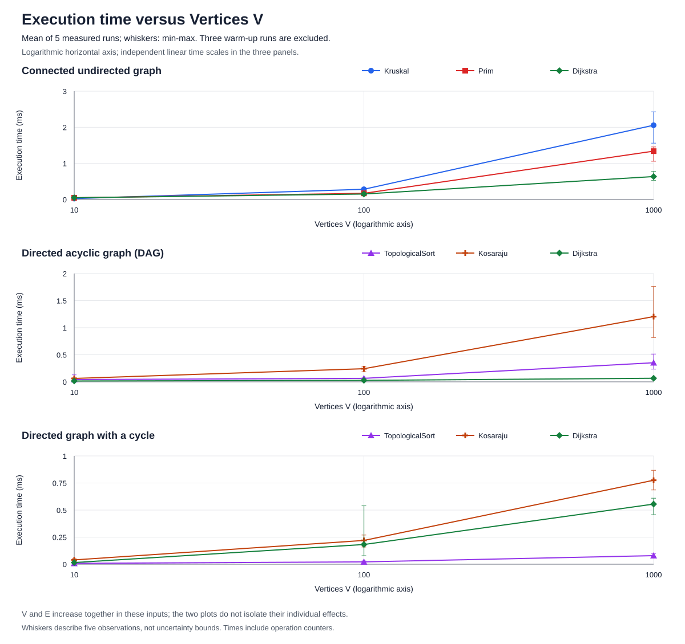
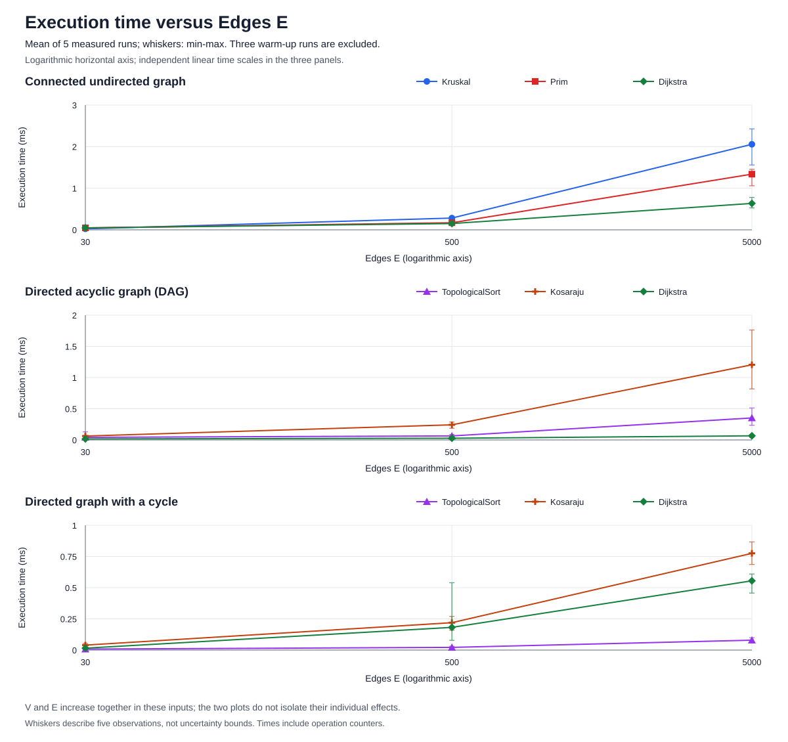

# Smart City Infrastructure and Route Planning

A Java console project for Design and Analysis of Algorithms, Assignment 3.
The city is modeled as a graph to study infrastructure costs, connectivity,
and shortest routes.

## Project status

The project includes a weighted graph model, a disjoint set union structure,
Kruskal and Prim minimum spanning forest algorithms, topological sorting with
cycle detection, strongly connected components, and Dijkstra shortest paths
with route reconstruction. Correctness tests and build commands are included.
The console application demonstrates all algorithms on small city graphs,
including disconnected, cyclic, and unreachable cases. A seeded connected
undirected graph generator and separate DAG and cyclic directed generators
are available for the required input sizes. A shared timing and CSV runner
measures all five algorithms across connected undirected, DAG, and cyclic
directed scenarios. The report below includes complete result tables,
reproducible plots, operation counts, and the interpretation of the measurements.

Repository: [kanatovs/assignment3-smart-city](https://github.com/kanatovs/assignment3-smart-city).

## Build and run

### Requirements

- JDK 17 or newer, including both `java` and `javac`.
- Windows PowerShell 5.1 or newer for the convenience script.
- No external Java libraries, Maven, or Gradle are required.

The script uses `JAVA_HOME` when it is set. Otherwise, it finds `javac` on
`PATH` and uses `java` from the same directory. This avoids mixing a Java 17
compiler with an older Java runtime. A `JAVA_HOME` pointing to a JRE is not
sufficient.

From the repository root:

```powershell
powershell -NoProfile -ExecutionPolicy Bypass -File .\scripts\project.ps1 check
powershell -NoProfile -ExecutionPolicy Bypass -File .\scripts\project.ps1 run
```

Both commands rebuild the generated classes from scratch. `check` compiles the
application and tests with all compiler warnings enabled and treated as errors,
checks the console examples, and runs every `*Test.java` class under
`src/test/java`. Each test class has a `main` method and a package matching its
directory. A failed test stops the command with a nonzero exit code.

`run` compiles and prints all six examples without running tests. No interactive
input is required. Commands also work from other directories when the script
is called by its full path.

After correctness checks, run the complete experiment suite:

```powershell
powershell -NoProfile -ExecutionPolicy Bypass -File .\scripts\project.ps1 benchmark
```

This command rebuilds production sources and writes `all-runs.csv`,
`all-summary.csv`, and `all-environment.csv` under the repository's
`results/tables/`, even when invoked from another working directory. It measures
27 algorithm/input groups with five runs each: 135 raw intervals in total.
Each group also receives three untimed warm-up calls. The saved report uses the
complete capture in `all-*.csv`; the focused MST files retain an earlier capture.

To collect only the MST measurements:

```powershell
powershell -NoProfile -ExecutionPolicy Bypass -File .\scripts\project.ps1 benchmark-mst
```

The focused command writes `mst-runs.csv`,
`mst-summary.csv`, and `mst-environment.csv` under the repository's
`results/tables/`, even when invoked from another working directory.
Rerunning either command replaces its own three CSV files with a fresh capture.
A custom output directory can be supplied without changing the saved report
data:

```powershell
powershell -NoProfile -ExecutionPolicy Bypass -File .\scripts\project.ps1 benchmark -ResultsDirectory '.\build\graph sample'
```

Relative custom paths are resolved from the caller's working directory.

Generate both plots from the saved complete capture:

```powershell
powershell -NoProfile -ExecutionPolicy Bypass -File .\scripts\plot-results.ps1
powershell -NoProfile -ExecutionPolicy Bypass -File .\scripts\check-plots.ps1
```

The plotting script requires only PowerShell 5.1 or newer and its standard
libraries. It reads `all-runs.csv` and `all-summary.csv`, checks their coverage
and arithmetic, and writes `results/plots/time-vs-vertices.svg` and
`results/plots/time-vs-edges.svg`. It does not rerun Java or alter measurements.
SVG output is deterministic for unchanged input. Custom locations are supported:

```powershell
powershell -NoProfile -ExecutionPolicy Bypass -File .\scripts\plot-results.ps1 -ResultsDirectory '.\build\graph sample' -PlotsDirectory '.\build\graph plots'
```

Each plot has one panel per scenario. Points show five-run mean milliseconds;
whiskers show the observed minimum and maximum, not confidence intervals.
Straight connectors help follow the three measured sizes and do not represent
additional samples. The horizontal axis is logarithmic; each panel uses its
own linear vertical scale. Both V and E change between these inputs.

`check-plots.ps1` verifies marker values and min-max ranges against the CSV,
valid XML and encoding, byte-identical regeneration, rejection of malformed
captures, and valid rendering coordinates for zero-duration samples. It uses
temporary files under ignored `build/` and leaves the saved report unchanged.

`-ExecutionPolicy Bypass` permits the local script in this PowerShell process
only; it does not change the machine or user execution policy. It is needed on
the current development machine because its default policy blocks `.ps1` files.

To select a JDK explicitly for the current PowerShell session:

```powershell
$env:JAVA_HOME = 'C:\path\to\jdk-17'
powershell -NoProfile -ExecutionPolicy Bypass -File .\scripts\project.ps1 check
```

For the current source files, the equivalent commands on Linux or macOS are:

```sh
mkdir -p build/classes build/test-classes
find src/main/java -name '*.java' | sort > build/main-sources.txt
javac --release 17 -encoding UTF-8 -Xlint:all -Werror \
  -d build/classes @build/main-sources.txt
find src/test/java -name '*.java' | sort > build/test-sources.txt
javac --release 17 -encoding UTF-8 -Xlint:all -Werror \
  -cp build/classes -d build/test-classes @build/test-sources.txt
java -cp build/classes:build/test-classes cityplanner.graph.WeightedGraphTest
java -cp build/classes:build/test-classes cityplanner.dsu.DisjointSetUnionTest
java -cp build/classes:build/test-classes cityplanner.mst.KruskalTest
java -cp build/classes:build/test-classes cityplanner.mst.PrimTest
java -cp build/classes:build/test-classes cityplanner.connectivity.TopologicalSortTest
java -cp build/classes:build/test-classes cityplanner.connectivity.KosarajuTest
java -cp build/classes:build/test-classes cityplanner.shortestpath.DijkstraTest
java -cp build/classes:build/test-classes cityplanner.MainTest
java -cp build/classes:build/test-classes cityplanner.experiments.ConnectedGraphGeneratorTest
java -cp build/classes:build/test-classes cityplanner.experiments.DirectedGraphGeneratorTest
java -cp build/classes:build/test-classes cityplanner.experiments.BenchmarkRunnerTest
java -cp build/classes:build/test-classes cityplanner.experiments.BenchmarkCsvTest
java -cp build/classes:build/test-classes cityplanner.experiments.MstExperimentsTest
java -cp build/classes:build/test-classes cityplanner.experiments.GraphExperimentsTest
java -cp build/classes cityplanner.Main
java -cp build/classes cityplanner.experiments.MstExperiments results/tables
java -cp build/classes cityplanner.experiments.GraphExperiments results/tables
```

These Unix commands have not yet been executed on a Unix system.

Each example prints its vertex IDs, names, and input edges before the results.
`--` means an undirected connection, while `->` means a directed edge or a step
along a route. Dependency weights of zero and SCC example weights of one are
placeholders; those algorithms use direction and reachability rather than cost.

| Console example | Expected result |
| --- | --- |
| Connected infrastructure | Kruskal and Prim each select four edges with total weight 21 |
| Infrastructure with an isolated airport | Both return a forest of weight 21 with two components |
| Construction dependencies: DAG | Every task appears once, with prerequisites before dependents |
| Construction dependencies: cycle | No complete topological order exists |
| Directed district connections | Three SCCs: `{Center, North, East}`, `{South, West}`, `{Airport}` |
| Routes from Center | West is at distance 7; Airport is unreachable |

Selected lines from the current output (the complete output also includes
input edges, selected MST edges, and the other routes):

```text
Smart City Infrastructure and Route Planning

=== Infrastructure: connected districts ===
Kruskal MST: weight=21, components=1, connected=true
Prim MST: weight=21, components=1, connected=true
Total weights agree: true

=== Infrastructure: isolated airport ===
Kruskal forest: weight=21, components=2, connected=false
Prim forest: weight=21, components=2, connected=false

=== Dependencies: DAG ===
Topological order: Survey -> Budget -> Park -> Roadwork -> Inspection

=== Dependencies: cycle ===
No topological order: directed cycle detected.

=== Directed districts: strongly connected components ===
SCC count: 3

=== Routes: shortest paths ===
Source: Center
  West: distance=7, path=Center -> East -> North -> South -> West
  Airport: unreachable
```

## Overview

The graph model uses vertices for city districts, edges for connections, and
weights for construction costs or travel distances. It supports directed and
undirected graphs. Minimum spanning trees require undirected graphs, while
the directed connectivity tasks use one-way connections. Shortest-path
experiments use non-negative edge weights.

The project answers four related questions: how cheaply to connect districts
(Kruskal and Prim), which construction tasks can be ordered (topological
sorting), which districts are mutually reachable (Kosaraju), and how far each
district is from one starting point (Dijkstra). DSU supports Kruskal's cycle
checks. Each implementation is tested separately before the same algorithms
are used in the console examples and reproducible experiments.

## Implementation

Current project layout:

```text
.
|-- .gitattributes
|-- .gitignore
|-- README.md
|-- scripts/
|   |-- check-plots.ps1
|   |-- project.ps1
|   `-- plot-results.ps1
|-- results/
|   |-- plots/
|   |   |-- time-vs-edges.svg
|   |   `-- time-vs-vertices.svg
|   `-- tables/
|       |-- all-environment.csv
|       |-- all-runs.csv
|       |-- all-summary.csv
|       |-- mst-environment.csv
|       |-- mst-runs.csv
|       `-- mst-summary.csv
`-- src/
    |-- main/java/cityplanner/
    |   |-- Main.java
    |   |-- graph/
    |   |   |-- Edge.java
    |   |   `-- WeightedGraph.java
    |   |-- dsu/
    |   |   `-- DisjointSetUnion.java
    |   |-- mst/
    |   |   |-- Kruskal.java
    |   |   |-- MstResult.java
    |   |   `-- Prim.java
    |   |-- connectivity/
    |   |   |-- Kosaraju.java
    |   |   |-- SccResult.java
    |   |   |-- TopologicalSort.java
    |   |   `-- TopologicalSortResult.java
    |   |-- shortestpath/
    |   |   |-- Dijkstra.java
    |   |   `-- DijkstraResult.java
    |   `-- experiments/
    |       |-- BenchmarkCsv.java
    |       |-- BenchmarkRunner.java
    |       |-- ConnectedGraphGenerator.java
    |       |-- DirectedGraphGenerator.java
    |       |-- GraphExperiments.java
    |       `-- MstExperiments.java
    `-- test/java/cityplanner/
        |-- MainTest.java
        |-- graph/
        |   `-- WeightedGraphTest.java
        |-- dsu/
        |   `-- DisjointSetUnionTest.java
        |-- mst/
        |   |-- KruskalTest.java
        |   `-- PrimTest.java
        |-- connectivity/
        |   |-- KosarajuTest.java
        |   `-- TopologicalSortTest.java
        |-- shortestpath/
        |   `-- DijkstraTest.java
        `-- experiments/
            |-- BenchmarkCsvTest.java
            |-- BenchmarkRunnerTest.java
            |-- ConnectedGraphGeneratorTest.java
            |-- DirectedGraphGeneratorTest.java
            |-- GraphExperimentsTest.java
            `-- MstExperimentsTest.java
```

`Main` builds the small example graphs, calls the existing algorithm classes,
and prints their results using district or task names. Algorithms still use
integer vertex IDs; names belong to the console presentation. The PowerShell
script compiles the source files with `javac` and runs the application with
`java`, using tools from the same JDK.

### Graph representation

`WeightedGraph(vertexCount, directed)` creates a fixed set of vertices numbered
from `0` to `vertexCount - 1`. An empty graph is allowed; a negative vertex count
is rejected. `addEdge(from, to, weight)` checks both vertex IDs before changing
the graph. Invalid IDs cause `IllegalArgumentException` without adding an edge.

`Edge` is an immutable Java record with `from`, `to`, and `weight` values.
Weights use `int` and may be zero or negative. Negative weights are valid graph
data; a shortest-path algorithm that cannot handle them must reject them.

An edge is stored once in the logical edge list returned by `edges()`.
For an undirected edge, adjacency contains both orientations. A self-loop is
stored only once in both the logical list and its adjacency list. Parallel
edges, including identical edges, are allowed and count separately in
`edgeCount()`. All lists preserve insertion order.

`edgesFrom(vertex)` returns outgoing adjacency entries, each with that vertex
as `from`. Both it and `edges()` return read-only live views: callers cannot
change the lists, but later additions to the graph are visible through an
existing view. The mutable graph is intended for single-threaded use.

For example, this graph has two logical edges and one isolated vertex:

```java
WeightedGraph graph = new WeightedGraph(4, false);
graph.addEdge(0, 1, 7);
graph.addEdge(1, 2, 4);
```

`edgesFrom(1)` contains `(1, 0, 7)` and `(1, 2, 4)`, while `edgesFrom(3)` is empty.

### Disjoint Set Union

`DisjointSetUnion(elementCount)` starts with one group per element, numbered
from `0` to `elementCount - 1`. Zero elements are allowed; a negative count is
rejected. The structure stores a parent and a group size in two integer arrays.

`find(element)` returns the root representing its group. It first follows parent
links to the root, then makes every element on that path point directly to the
root. This path compression shortens later searches. Both passes are iterative.

`union(first, second)` finds both roots and attaches the smaller group below
the larger group. This union-by-size rule prevents long chains. A successful
merge returns `true` and reduces `componentCount()` by one. If both elements
already share a group, it returns `false` and leaves the group count unchanged.
Root IDs are implementation details and can change after a merge.

Both arguments are validated before a union changes any parents or counters.
Invalid element IDs cause `IllegalArgumentException`. The arrays are private;
callers change group membership through `union`. Even `find` can change parents
through compression, so this structure is intended for single-threaded use.

The structure records these counters for later performance measurements:

| Counter | Meaning |
| --- | --- |
| `findCalls()` | Valid `find` calls, including the two searches inside each valid `union` |
| `unionCalls()` | Valid merge attempts, including attempts on an already connected pair |
| `parentTraversals()` | Parent links followed in both the root search and compression pass |

A search starting `h` links below its root counts `2h` parent traversals.
A root search counts zero traversals. Invalid calls do not change the counters.
Construction does not count as a search or merge; counters start at zero.

### Kruskal

`Kruskal.findMinimumSpanningForest(graph)` accepts an undirected weighted graph.
It copies the logical edge list, sorts the copy by ascending weight, and uses
a fresh DSU to decide whether an edge joins two different groups. An edge is
selected only when `union` succeeds, so self-loops and cycle-forming edges are
skipped. Processing stops when a single component remains; disconnected inputs
require examining every edge. Sorting still covers all input edges.

Sorting uses `Integer.compare` rather than subtracting weights, which avoids
overflow when comparing extreme integer values. Equal-weight edges retain
their insertion order. The original graph and its edge order are unchanged.

`MstResult` contains the selected edges, a `long` total weight, and the remaining
component count. Its edge list is a defensive read-only copy. A result is
connected when it has exactly one component. For connected input this is an
MST; for disconnected input it is a minimum spanning forest covering every
component, including isolated vertices. The result contains `V - componentCount`
edges. Zero and negative weights and parallel edges are supported.

A single-vertex graph has a connected result with no edges and weight zero.
An empty graph has no edges, weight zero, and zero components; this project
reports it as not connected. Directed input is rejected with
`IllegalArgumentException`; null input is rejected with `NullPointerException`.

For the four-vertex example above, the result contains the two existing edges
with total weight 11 and two components. It is a forest rather than an MST.

| Counter on `Kruskal` | Meaning |
| --- | --- |
| `sortingComparisons()` | Comparator calls while sorting the complete edge copy |
| `edgeExaminations()` | Edges visited after sorting, before early termination |
| `findCalls()` | DSU root searches, including those inside unions |
| `unionCalls()` | DSU merge attempts; one per examined edge |
| `parentTraversals()` | DSU parent links followed in both search passes |

Counters reset for each valid call and describe its execution. Each examined
edge causes one union attempt and two finds. Read counters before reusing the
same instance for another graph. Invalid input is rejected before counters
are reset. The algorithm instance is intended for single-threaded use.

### Prim

`Prim.findMinimumSpanningForest(graph)` grows a tree from an unvisited vertex.
It marks the vertex as visited and adds its edges to unvisited neighbors to a
`PriorityQueue`, ordered by weight using `Integer.compare`. The lightest edge
is removed next. If its target is still unvisited, the edge is selected and the
new vertex's outgoing edges are scanned. If its target has already been visited,
the queue entry is obsolete and is skipped. This is a lazy edge-queue version
of Prim; no DSU is used.

When the queue becomes empty, the algorithm starts from the next unvisited
vertex. This covers every disconnected component and counts isolated vertices,
rather than returning only the first component's tree. Self-loops are scanned
but never queued. Parallel edges, repeated weights, and negative weights are
supported.

Prim returns the same immutable `MstResult` as Kruskal, with a `long` total
weight and the same empty, single-vertex, and input-validation conventions.
Selected edges point from a visited vertex to a newly visited vertex, so their
orientation can be the reverse of the original undirected input edge. Both
orientations represent the same connection. Input adjacency and edge order are
preserved. Equal-weight choices need not match Kruskal's selected edge list.

| Counter on `Prim` | Meaning |
| --- | --- |
| `edgeExaminations()` | Adjacency entries scanned when visiting vertices |
| `queueOffers()` | Edges inserted into the priority queue |
| `queuePolls()` | Edges removed, including obsolete entries |
| `queueComparisons()` | Weight comparator calls during queue operations |

Every vertex is visited once, and each component's queue is fully drained.
For `E` logical edges including `L` self-loops, this representation yields
`2E - L` adjacency examinations and `E - L` queue offers and polls. A non-loop
edge is queued once, when its first endpoint is visited. These counts use
different definitions from Kruskal's logical edge examinations and must not be
treated as identical units of work.

All counters reset for a valid call, and visited state and the queue are fresh
on every invocation. Rejected input preserves previous counters. Read counters
before reusing the algorithm instance; it is intended for single-threaded use.

### Topological sorting

`TopologicalSort.sort(graph)` uses Kahn's algorithm on a directed graph. An
edge `u -> v` means that `u` must be processed before `v`. Edge weights do not
affect this ordering, so zero, negative, and extreme integer weights are allowed.
Undirected input causes `IllegalArgumentException`, and null input causes
`NullPointerException` before any counters are reset.

The algorithm first counts incoming edges for every vertex. All vertices with
zero indegree enter an `ArrayDeque`. Removing a vertex adds it to the order and
decreases the indegree of each outgoing neighbor. A neighbor enters the queue
when its remaining indegree becomes zero. Parallel edges are counted and
removed separately. The graph itself is never modified, and every component,
including isolated vertices, is considered.

`TopologicalSortResult` contains an immutable snapshot `order()` and a boolean
`hasCycle()`. If all vertices are processed, the order contains every vertex
once and places every edge's source before its target. Otherwise, a directed
cycle prevents a complete ordering: `hasCycle()` is true and `order()` is empty.
Any processed prefix is discarded. A self-loop is a cycle. The result reports
the existence of a cycle without returning its vertices. Its constructor rejects
a cyclic result with a nonempty order.

An empty directed graph has a valid empty order and no cycle. A single isolated
vertex has the order `[0]`. Different valid orders may exist: if only `0 -> 2`
and `1 -> 2` are present, both `[0, 1, 2]` and `[1, 0, 2]` satisfy all
dependencies. The FIFO queue uses ascending vertex IDs for the initial entries
and adjacency insertion order for newly available neighbors. It is repeatable
for an unchanged graph but does not promise the smallest lexicographic order.

| Counter on `TopologicalSort` | Meaning |
| --- | --- |
| `indegreeEdgeExaminations()` | Logical edges scanned to initialize indegrees; always `E` for valid input |
| `processingEdgeExaminations()` | Outgoing adjacency entries scanned from processed vertices |
| `edgeExaminations()` | Sum of the two phase counters |

For a DAG, processing examines another `E` edges, for a total of `2E`.
For a cyclic graph, processing can stop before all edges are examined, so the
total lies between `E` and `2E`. These counts exclude the loops over vertices.
Every valid invocation resets counters and creates fresh indegrees, queue, and
order. Invalid input preserves the previous counters. Read counters before
reusing the instance; it is intended for single-threaded use.

### Strongly connected components

`Kosaraju.findStronglyConnectedComponents(graph)` partitions a directed graph
into strongly connected components (SCCs). Within a component, each vertex can
reach every other vertex by directed paths. One-way reachability between two
groups does not make them one component. A DAG therefore has one component per
vertex, even if its underlying undirected graph is connected.

Kosaraju uses two iterative depth-first searches and a reversed graph:

1. Visit all vertices in the original graph and record each vertex after its
   outgoing edges have been examined. An explicit stack and a next-edge index
   per vertex preserve DFS finishing order without recursion.
2. Create another `WeightedGraph` with the same vertices and every edge
   reversed. Weights and parallel-edge multiplicity are preserved; the original
   graph is unchanged.
3. Clear visited flags and search the reversed graph in decreasing finishing
   order. Every search starting at an unvisited vertex produces one component.
   Vertices are marked when pushed, so each enters the stack only once per pass.

Decreasing finishing order prevents the second pass from merging different
unassigned components. Reversing edges preserves mutual reachability within
each SCC while changing the direction of connections between SCCs.

`SccResult.components()` is a detached snapshot whose outer list and every
inner list are read-only. `componentCount()` gives the number of groups. Every
vertex belongs to exactly one nonempty group; empty input produces no groups.
A single isolated vertex, or a vertex with only self-loops, forms one group.
The result constructor copies both list levels and rejects empty inner groups
and null lists or members. Component order and vertex order within a group are
traversal details, so callers should compare membership rather than list order.

Self-loops, parallel edges, and arbitrary integer weights are supported.
Weights do not affect reachability. Undirected input is rejected with
`IllegalArgumentException`, and null input with `NullPointerException`, before
any counters are reset. The mutable algorithm instance is for single-threaded
use; valid invocations reset counters and allocate fresh traversal state.

| Counter on `Kosaraju` | Meaning |
| --- | --- |
| `firstPassEdgeExaminations()` | Original outgoing edges scanned to obtain finishing order |
| `reversalEdgeExaminations()` | Logical edges read while constructing the reversed graph |
| `secondPassEdgeExaminations()` | Reversed outgoing edges scanned while collecting components |
| `edgeExaminations()` | Sum of the three phase counters |

Each phase examines exactly `E` edges, including loops and parallel edges, so
the total is `3E` for every valid run. Vertex loops, stack operations, allocation,
and result copying are outside these counters. Invalid calls preserve previous
values; read counters before reusing the instance.

### Dijkstra

`Dijkstra.findShortestPaths(graph, source)` finds shortest distances from a
valid source in either a directed or undirected graph. Before changing counters
or creating traversal state, it validates the source and scans all logical
edges for negative weights, including edges in unreachable components.
Negative weights and invalid sources cause `IllegalArgumentException`; null
input causes `NullPointerException`. An empty graph has no valid source.

Distances begin at `DijkstraResult.UNREACHABLE` (`Long.MAX_VALUE`), except the
source distance of zero. A `PriorityQueue` holds vertex-distance entries,
ordered with `Long.compare`. For each current entry, outgoing edges are relaxed:
if an edge gives a strictly smaller distance, the distance and predecessor
are updated and a new queue entry is added. A polled entry whose distance no
longer matches the best known distance is obsolete and skipped before scanning
adjacency. Each reachable vertex's outgoing list is therefore scanned once.

Non-negative weights ensure that a current minimum-distance entry cannot later
receive a shorter route. Negative weights would invalidate that reasoning.
Self-loops, parallel edges, zero weights, and zero-weight cycles are supported.
Equal-distance alternatives do not replace predecessors or add queue entries,
so ties do not create predecessor cycles. Different optimal paths may exist;
the API does not promise one particular path when distances tie.

All distances and additions use `long`, and `Math.addExact` prevents silent
overflow. With this model's integer vertex count and non-negative integer
weights, a shortest simple path costs at most `(V - 1) * Integer.MAX_VALUE`.
Even extending that distance by one edge fits in `long`, so the unreachable
sentinel is distinct from every finite distance the graph can produce.

`DijkstraResult` stores private copies of the distances and predecessors; its
constructor is package-private. `source()` and `vertexCount()` identify the
result, `distanceTo(vertex)` returns a distance or the unreachable sentinel,
and `isReachable(vertex)` distinguishes the two. `pathTo(vertex)` follows
predecessors iteratively and reverses the sequence into an immutable list of
vertex IDs. The source path is `[source]`; an unreachable target has an empty
path. Invalid target IDs cause `IllegalArgumentException`. The input graph and
earlier results remain unchanged by later graph edits or algorithm calls.

| Counter on `Dijkstra` | Meaning |
| --- | --- |
| `validationEdgeExaminations()` | Logical edges checked for negative weights; `E` for valid input |
| `processingEdgeExaminations()` | Outgoing adjacency entries scanned from reachable vertices |
| `edgeExaminations()` | Sum of validation and processing edge scans |
| `relaxationAttempts()` | One attempt per processing edge scan; the same count as `processingEdgeExaminations()` |
| `successfulRelaxations()` | Strict distance improvements |
| `queueOffers()` | Initial source entry plus one entry per successful relaxation |
| `queuePolls()` | Entries removed, including obsolete entries |
| `queueComparisons()` | Distance comparator calls during heap operations |

For `R` outgoing adjacency entries from reachable vertices, processing performs
`R` scans and relaxation attempts; total edge examinations are `E + R`.
Directed adjacency contains one entry per edge; undirected non-loop edges have
two entries. Unreachable vertices do not enter the queue. Every offered entry
is eventually polled, so offers and polls both equal successful relaxations
plus one. Counters exclude later result queries and path reconstruction; do
not sum overlapping scan and attempt counts as independent work.
Valid calls reset counters, and rejected calls preserve the previous values.
The algorithm instance is intended for single-threaded use.

### Connected graph generation

`ConnectedGraphGenerator.generate(vertexCount, edgeCount, seed)` creates a
fresh connected undirected `WeightedGraph`. It accepts `V >= 1` and
`V - 1 <= E <= V * (V - 1) / 2`; invalid sizes cause
`IllegalArgumentException` before graph allocation. Capacity arithmetic uses
`long` to avoid overflow. A single vertex with zero edges is valid. Empty
input is rejected because this generator promises a connected result.

Each call creates its own `Random(seed)`. A Fisher-Yates shuffle gives a
vertex order, then every vertex after the first connects to a randomly chosen
earlier vertex. These `V - 1` edges form a spanning tree. All later additions
preserve connectivity. Weights are integers from `MIN_WEIGHT = 0` through
`MAX_WEIGHT = 100`, inclusive; repeated weights are allowed.

For extra edges, the generator visits unordered pairs `u < v`, skipping tree
edges using a set of canonical endpoint keys. If `k` more edges are needed
among `r` remaining pairs, the current pair is selected when
`random.nextLong(r) < k`. Remaining counts are updated after each decision.
This samples extra edges without replacement and stops when exactly `E` edges
exist. No self-loops or duplicate unordered connections are produced, including
when a tree edge has the opposite stored orientation. Complete graphs are
supported by the same bounded pair traversal.

The same `(V, E, seed)` reproduces the logical edge order, orientations, and
weights. Separate calls do not share random state or graph storage. The
distribution over connected graphs is not uniform. The result can be passed
directly to Kruskal, Prim, and Dijkstra. The console examples remain fixed;
the generator is currently a Java API for reproducible experimental inputs.

### Directed graph generation

`DirectedGraphGenerator.generateDag(V, E, seed)` shuffles the vertices using
Fisher-Yates, then selects edges only from earlier to later positions in that
order. A cycle would have to return to an earlier position, so every generated
graph is a DAG. Numeric vertex IDs do not have to increase along its edges.
Valid sizes are `V >= 0` and `0 <= E <= V * (V - 1) / 2`; empty graphs and
isolated vertices are supported. No connectivity requirement is imposed.

`DirectedGraphGenerator.generateCyclic(V, E, seed)` guarantees a directed
cycle without self-loops. It first shuffles the vertices and connects the first
three in a cycle. When only two vertices or two edges are requested, it uses a
two-vertex cycle instead. Extra edges are chosen from all remaining ordered
pairs of distinct vertices. Valid sizes are `V >= 2` and
`2 <= E <= V * (V - 1)`. Opposite edges `u -> v` and `v -> u` are distinct and
allowed; repeating the same ordered pair is forbidden. Added edges can merge
SCCs, while vertices outside the initial cycle can remain isolated.

Both methods reject impossible sizes with `IllegalArgumentException` before
graph allocation and use `long` for capacities. They return fresh directed
`WeightedGraph` instances with exactly `E` logical edges and integer weights
in `[0, 100]`, inclusive. Each method has its own `Random(seed)` per invocation.
The same parameters and method reproduce edge order, directions, weights, and
adjacency. Calls and returned graphs do not share mutable state. Both overall
graph distributions are non-uniform.

Extra edges use the same remaining-needed selection rule as the undirected
generator: choose the current eligible pair when `random.nextLong(r) < k`,
where `r` pairs remain and `k` edges are still needed. Each eligible pair is
considered at most once, and initial cycle edges are skipped using ordered
endpoint keys.
No self-loops or duplicate directed edges are generated, including for complete
allowed edge sets. DAG and cyclic inputs are separate scenarios for topological
sorting, SCC analysis, and Dijkstra.

Every SCC in a DAG is a singleton. The initial directed cycle belongs to an
SCC with at least two vertices, even if later edges enlarge that component.

### Timing and CSV runner

`BenchmarkRunner` measures algorithm tasks and captures immutable raw runs.
A `GraphCase` records scenario, size, seed, and direction; an `Algorithm`
provides a factory for a fresh task. Only `Task.execute()` is inside the timer.
Result fields and operation counters are copied after the stop timestamp.
`summarize` groups rows by the complete input metadata and algorithm name,
requires five distinct run numbers, checks stable outcomes and counter schemas,
and averages each counter separately. Floating-point accumulation avoids
overflowing a `long` sum; raw nanoseconds remain integers.

`MstExperiments` generates one connected graph per required size and passes
that same graph to both factories. Every task contains a new Kruskal or Prim
instance. Its timed operation calls the existing forest method and stores its
result. After measurement, both methods must report one component, `V - 1`
selected edges, and the same total weight. Exceptions stop the experiment.

`GraphExperiments` uses the same runner and CSV exporter for the complete suite.
Each connected undirected graph is shared by Kruskal, Prim, and Dijkstra. Each
DAG or cyclic directed graph is shared by topological sorting, Kosaraju, and
Dijkstra. Factories create fresh tasks and algorithm instances for every call.
Only the algorithm method and storing its result are timed; extracting outcome
statistics and verifying complete coverage happen afterward.

The complete-suite verifier requires all nine prescribed inputs and all three
applicable algorithms for each. It checks MST agreement, DAG and cyclic flags,
DAG order lengths, SCC coverage and size ranges, and shortest-path source and
reachability totals. A failed check stops export. Algorithm correctness is also
checked separately by the tests described below.

| Algorithm | Exported outcome fields |
| --- | --- |
| Kruskal and Prim | `total_weight`, `component_count`, `selected_edges` |
| Topological sorting | `has_cycle` (`0` or `1`), `ordered_vertices` |
| Kosaraju | `component_count`, `largest_component`, `covered_vertices` |
| Dijkstra | `source`, `reachable_vertices`, `unreachable_vertices`, `distance_sum`, `max_distance` |

Dijkstra outcome statistics include only finite distances. `distance_sum` is
their checked `long` sum; `max_distance` is their maximum, including the source's
zero distance. Unreachable targets contribute to their own count and are never
added as the infinity sentinel. These statistics are extracted outside timing;
the console examples show individual distances and reconstructed paths.

`BenchmarkCsv` exports UTF-8 CSV with LF record separators. Named counter and
result columns are sorted. A counter that does not apply to an algorithm has
an empty cell, which is different from zero. CSV quoting preserves commas,
quotes, line breaks, and Unicode. Environment metadata is a separate key/value
file. Output validation happens before writing; filesystem errors propagate.

## Complexity Analysis

The graph representation requires `O(V + E)` storage. Each undirected non-loop
edge contributes two adjacency entries, which does not change this bound.

| Graph operation | Time |
| --- | --- |
| Create a graph | `O(V)` |
| Add an edge | Amortized `O(1)` |
| Read vertex count, edge count, or direction | `O(1)` |
| Obtain an edge or adjacency view | `O(1)` |
| Iterate all logical edges | `O(E)` |
| Iterate outgoing edges from a vertex | `O(outgoing adjacency entries)` |

DSU initialization takes `O(V)` time and its arrays require `O(V)` space.
`find` and `union` take amortized `O(alpha(V))` time with path compression and
union by size, where `alpha` is the inverse Ackermann function and grows very
slowly. This is an amortized bound over a sequence, not a constant-time guarantee
for each call. A single search can still take `O(log V)` time. Counts and counter
getters take `O(1)` time.

Union by size limits tree depth by attaching a smaller group below a larger
one. Path compression then reduces the depth of visited elements. The iterative
implementation uses `O(1)` extra space for a search or merge.

Kruskal copies and sorts `E` logical edges, initializes a DSU for `V` vertices,
and makes at most `E` union attempts. Its worst-case time is
`O(V + E log(E + 1) + E alpha(V))`, including initialization and the result
copy. Sorting contributes the usual `O(E log E)` term for `E >= 2`. The explicit
`V` term matters for sparse or disconnected graphs with many isolated vertices.
Extra space is `O(V + E)` for the DSU, edge copy, sorting storage, and result.
Early termination reduces edge processing but does not skip copying or sorting.

Prim scans all adjacency lists in `O(V + E)` time. The lazy queue can contain
`O(E)` edge entries; at most `E` insertions and `E` removals each cost
`O(log(E + 1))`. The overall worst-case time is `O(V + E log(E + 1))`, and extra
space is `O(V + E)` for visited flags, queue entries, selected edges, and the
immutable result. For simple graphs the logarithmic factor can be expressed
using `V`; the `E` bound also covers this model's parallel edges.

Topological sorting initializes indegrees in `O(V + E)` time and processes
each vertex at most once, scanning its outgoing edges once. The overall time
is `O(V + E)`, including the result copy, even when a cycle prevents processing
some vertices. Extra space is `O(V)` for indegrees, the FIFO queue, the order,
and its immutable snapshot. The implementation is iterative and uses no
recursive DFS or reversed graph.

Kosaraju takes `O(V + E)` time: both DFS passes visit every vertex and scan
every outgoing edge, and graph reversal copies every edge once. The result
contains `V` vertex memberships and at most `V` components, so its defensive
copy also takes `O(V)`. Extra space is `O(V + E)`: the reversed graph stores
`V` adjacency lists and `E` edge records with references in its logical edge
list and adjacency lists; visited flags, next-edge indices, stacks, finishing
order, and the result require `O(V)` additional space. Both searches use explicit
stacks rather than the Java call stack.

Dijkstra initializes arrays in `O(V)` time and validates all logical edges in
`O(E)`, including unreachable components. Each reachable adjacency entry is
scanned once and can cause at most one successful relaxation. The lazy queue
can contain `O(E + 1)` entries, so the overall worst-case time is
`O(V + E log(E + 1))`, including validation and copying the result arrays.
This edge-based heap bound also covers parallel edges; for simple graphs the
logarithmic factor can be expressed using `V`. Extra space is `O(V + E)` for
distance and predecessor arrays, their result copies, and queued entries.
Distance and reachability queries take `O(1)`. Reconstructing a path of `k`
vertices takes `O(k)` time and extra space, with `k <= V`; paths are built only
when requested rather than stored for every target.

The main bounds, excluding the existing input graph but including returned
results, are summarized here:

| Algorithm or structure | Time | Extra space |
| --- | --- | --- |
| DSU | `O(V)` initialization; amortized `O(alpha(V))` per find/union | `O(V)` |
| Kruskal | `O(V + E log(E + 1) + E alpha(V))` | `O(V + E)` |
| Prim with a lazy edge heap | `O(V + E log(E + 1))` | `O(V + E)` |
| Topological sorting | `O(V + E)` | `O(V)` |
| Kosaraju | `O(V + E)` | `O(V + E)` |
| Dijkstra with a lazy heap | `O(V + E log(E + 1))` | `O(V + E)` |

Connected graph generation uses `O(V)` working storage for the vertex order
and tree-edge set, in addition to the returned graph's `O(V + E)` storage.
With expected constant-time hash lookups, tree-only generation takes `O(V)`
time. When extra edges are needed, at most `V * (V - 1) / 2` pairs are visited,
giving `O(V^2)` worst-case pair-processing time. No quadratic candidate-edge
list is allocated. Generation is outside algorithm timing boundaries.

Both directed generators use `O(V)` working storage for a shuffled order, plus
the returned graph's `O(V + E)` storage. The reserved cycle-edge set has at most
three entries. DAGs with no edges and cyclic graphs needing only the initial
cycle take `O(V)` generation time. Otherwise the pair traversal visits at most
`V * (V - 1) / 2` DAG candidates or `V * (V - 1)` directed candidates, giving
`O(V^2)` pair-processing time without a quadratic candidate list.

## Experimental Setup

The assignment requires graphs with `(V, E)` equal to `(10, 30)`, `(100, 500)`,
and `(1000, 5000)`. Experiments use fixed random seeds and five measured
runs per case, timed with `System.nanoTime()`.

The connected undirected input configuration is:

| Vertices | Logical edges | Seed | Dijkstra source |
| ---: | ---: | ---: | ---: |
| 10 | 30 | 41100 | 0 |
| 100 | 500 | 41101 | 0 |
| 1000 | 5000 | 41102 | 0 |

All three cases use weights in `[0, 100]`, no loops, and no parallel edges.
The initial spanning tree guarantees that source `0` can reach every vertex.
Kruskal, Prim, and Dijkstra receive the same graph. For example, the first
input can be recreated through the Java API:

```java
WeightedGraph graph = ConnectedGraphGenerator.generate(10, 30, 41100L);
```

The directed scenarios use separate seeds for each construction:

| Vertices | Edges | DAG seed | Cyclic seed | Dijkstra source |
| ---: | ---: | ---: | ---: | ---: |
| 10 | 30 | 41200 | 41300 | 0 |
| 100 | 500 | 41201 | 41301 | 0 |
| 1000 | 5000 | 41202 | 41302 | 0 |

Both directed modes use weights in `[0, 100]`, no loops, and no repeated ordered
pairs. DAGs have a valid topological order; cyclic scenarios always report a
cycle. SCC counts depend on actual connectivity. Source `0` is valid for all
prescribed cases, but directed reachability from it is not guaranteed; Dijkstra
keeps unreachable targets explicit. Examples of regeneration through the API:

```java
WeightedGraph dag = DirectedGraphGenerator.generateDag(10, 30, 41200L);
WeightedGraph cyclic = DirectedGraphGenerator.generateCyclic(10, 30, 41300L);
```

Graph seeds reproduce inputs; timings are measured afresh on every invocation.
The complete suite uses these algorithm/scenario combinations at every size:

| Scenario label | Algorithms in the initial order | Sizes | Measured rows |
| --- | --- | ---: | ---: |
| `connected-undirected` | Kruskal, Prim, Dijkstra | 3 | 45 |
| `dag-directed` | TopologicalSort, Kosaraju, Dijkstra | 3 | 45 |
| `cyclic-directed` | TopologicalSort, Kosaraju, Dijkstra | 3 | 45 |

Dijkstra always starts at vertex `0`, recorded in `result_source` on each of
its rows. This choice is fixed rather than selected to maximize reachability.
All connected undirected vertices are reachable; directed graphs may contain
unreachable targets. Topological sorting records `has_cycle = 0` and all `V`
ordered vertices for DAGs, or `has_cycle = 1` and zero ordered vertices for
cyclic inputs. Kosaraju records `V` singleton SCCs for a DAG; cyclic inputs
contain at least one SCC with more than one vertex.

For each graph, three untimed warm-up rounds exercise its algorithms. The
runner then performs five measured rounds using elapsed differences of
`System.nanoTime()`. Odd rounds use the initial order in the table; even rounds
reverse that order. The focused MST command uses only Kruskal and Prim in the
same alternating arrangement. Warm-up calls are excluded from raw rows and
averages. Every call gets a newly constructed task and algorithm instance
outside the timed region.
Warm-up and measured results must agree for each algorithm/input group.

The timed interval includes the full algorithm method: copying, sorting or
queue work, DSU or visited-state allocation, operation counter updates, and
result construction. It also includes task dispatch and storing the returned
result. Graph generation, factory construction, counter extraction, correctness
checks, CSV formatting, and file output are outside. Timings include the
algorithms' instrumentation; counters of different kinds are never combined
into one operation total. Clock and dispatch overhead are not subtracted.

The environment CSV records UTC capture time, Java and VM versions, operating
system and architecture, processors available to the JVM, its maximum heap,
warm-up and measured counts, timing scope, weight bounds, and algorithm order.
The complete-suite metadata also records its scenario, seed, and source policy.
Maximum heap is a JVM limit, not installed physical RAM. Three warm-ups and
five measurements form a small experiment; JVM compilation, garbage collection,
background activity, and timer overhead can affect the results, especially
for the smallest input. This is a simple instrumented Java benchmark.

The saved complete capture was collected on November 3, 2026, at
08:08:37 UTC. Its environment file records:

| Setting | Saved value |
| --- | --- |
| JDK | Eclipse Adoptium 17.0.17 |
| VM | OpenJDK 64-Bit Server VM, 17.0.17+10 |
| Operating system | Windows 11, version 10.0, amd64 |
| Processors available to the JVM | 16 |
| Maximum JVM heap | 4,196,401,152 bytes |
| Warm-up / measured calls per group | 3 / 5 |
| Weights / shortest-path source | Integers 0 through 100 / vertex 0 |

This metadata describes the recorded session, not a fixed environment required
to run the project. The heap value does not describe physical RAM.

Kruskal's complete method is the timing boundary: copying and sorting edges,
DSU initialization, edge selection, counter updates, and the immutable result
copy are included. Input generation and console/file output remain outside.

Prim's complete method uses the same timing boundary: visited state and
queue allocation, adjacency scans, heap operations, counters, and the result
copy are included. Both methods receive the same input graphs.

Topological sorting times the complete `sort` call, including indegree
initialization, queue and order allocation, both edge-scanning phases, cycle
detection, counters, and result construction. Graph generation and output
remain outside the timer; DAG and cyclic cases are labeled separately.

Kosaraju times the complete `findStronglyConnectedComponents` call,
including both DFS passes, reversed-graph construction, traversal allocations,
counter updates, and the deeply immutable result copy. Input generation and
output remain outside the timer. Results record component counts as well
as the separate edge-scan counters.

Dijkstra times the complete `findShortestPaths` call, including source and
negative-weight validation, distance and predecessor initialization, queue
operations, adjacency scans, checked addition, counters, and result-array
copies. Graph generation, result verification, path queries, and output remain
outside the timer. The source vertex and graph direction are recorded.

## Results

The complete capture contains 135 measured rows and 27 summary groups:

- [Raw intervals, counters, seeds, and outcomes](results/tables/all-runs.csv).
- [Five-run averages in nanoseconds and milliseconds](results/tables/all-summary.csv).
- [Capture environment and measurement settings](results/tables/all-environment.csv).
- [Execution time versus vertex count](results/plots/time-vs-vertices.svg).
- [Execution time versus edge count](results/plots/time-vs-edges.svg).

The plots read these saved CSV files. Their points show measured means and
their whiskers preserve the range of the five raw intervals. No timings are
hand-entered into the plotting script.

| Vertices | Edges | Kruskal total weight | Prim total weight |
| ---: | ---: | ---: | ---: |
| 10 | 30 | 101 | 101 |
| 100 | 500 | 1075 | 1075 |
| 1000 | 5000 | 11741 | 11741 |

Every measured MST result is connected and contains `V - 1` selected edges.
The raw file preserves all five intervals per algorithm/input; the summary
contains their arithmetic means and separate counter means. Reproducing the
command preserves graph-dependent results but produces new timings and capture
metadata. The earlier focused MST capture remains available separately as
[raw runs](results/tables/mst-runs.csv), [means](results/tables/mst-summary.csv),
and [environment](results/tables/mst-environment.csv). It is a different timing
session and is not used for the complete-suite plots.

### Mean execution time

All values below are arithmetic means of five measured calls, in milliseconds,
copied from `all-summary.csv`. A dash means the algorithm does not apply to
that scenario.

| Scenario | V | E | Kruskal | Prim | Topological sort | Kosaraju | Dijkstra |
| --- | ---: | ---: | ---: | ---: | ---: | ---: | ---: |
| Connected undirected | 10 | 30 | 0.02466 | 0.04692 | - | - | 0.04762 |
| Connected undirected | 100 | 500 | 0.28266 | 0.17014 | - | - | 0.15092 |
| Connected undirected | 1000 | 5000 | 2.05686 | 1.33906 | - | - | 0.63516 |
| DAG | 10 | 30 | - | - | 0.04204 | 0.06284 | 0.01620 |
| DAG | 100 | 500 | - | - | 0.06448 | 0.24256 | 0.02724 |
| DAG | 1000 | 5000 | - | - | 0.35282 | 1.20494 | 0.06620 |
| Cyclic directed | 10 | 30 | - | - | 0.00786 | 0.03982 | 0.01534 |
| Cyclic directed | 100 | 500 | - | - | 0.02152 | 0.21954 | 0.18202 |
| Cyclic directed | 1000 | 5000 | - | - | 0.07932 | 0.77542 | 0.55526 |





The two plots show the same 27 measurements against different input counts.
Their horizontal axes are logarithmic and their panel time scales differ.
Whiskers are the observed five-run min-max range. For example, cyclic Dijkstra
at `V = 100` ranges from `0.0782` to `0.5397` ms around its `0.18202` ms mean;
the spread remains visible rather than being removed from the data.

### MST operation counts

These are separate mean operation counts from the same complete capture.
They are integers because all five runs perform the same operations on the
same input. No single total combines sorting, DSU, and heap counters.

| V | Kruskal sorting comparisons | Examined edges / union calls | Find calls | Parent links traversed |
| ---: | ---: | ---: | ---: | ---: |
| 10 | 110 | 10 | 20 | 20 |
| 100 | 3841 | 226 | 452 | 740 |
| 1000 | 50435 | 3953 | 7906 | 14694 |

| V | Prim adjacency examinations | Queue offers | Queue polls | Queue comparisons |
| ---: | ---: | ---: | ---: | ---: |
| 10 | 60 | 30 | 30 | 208 |
| 100 | 1000 | 500 | 500 | 7683 |
| 1000 | 10000 | 5000 | 5000 | 110900 |

### Directed connectivity outcomes

Topological sorting initializes indegrees by examining all `E` edges in every
case. Its second phase processes the number of edges shown below. A DAG returns
all `V` ordered vertices; every cyclic case returns an empty order and reports
a cycle. Kosaraju's total edge examinations are `3E` in both scenarios.

| Scenario | V | E | Cycle reported | Ordering processing scans | SCC count | Largest SCC | SCC total edge scans |
| --- | ---: | ---: | --- | ---: | ---: | ---: | ---: |
| DAG | 10 | 30 | No | 30 | 10 | 1 | 90 |
| DAG | 100 | 500 | No | 500 | 100 | 1 | 1500 |
| DAG | 1000 | 5000 | No | 5000 | 1000 | 1 | 15000 |
| Cyclic directed | 10 | 30 | Yes | 6 | 3 | 8 | 90 |
| Cyclic directed | 100 | 500 | Yes | 3 | 2 | 99 | 1500 |
| Cyclic directed | 1000 | 5000 | Yes | 24 | 14 | 987 | 15000 |

### Shortest-path work and reachability

Every run starts at vertex `0`. Validation scans all `E` logical edges, including
unreachable regions. Processing scans only adjacency entries of reachable
vertices; in the undirected case this includes both orientations. Offers and
polls have the same count because the heap is drained, including stale entries.

| Scenario | V | Reachable / unreachable | Processing scans | Successful relaxations | Queue offers / polls | Queue comparisons |
| --- | ---: | --- | ---: | ---: | ---: | ---: |
| Connected undirected | 10 | 10 / 0 | 60 | 19 | 20 | 106 |
| Connected undirected | 100 | 100 / 0 | 1000 | 214 | 215 | 2639 |
| Connected undirected | 1000 | 1000 / 0 | 10000 | 1955 | 1956 | 36043 |
| DAG | 10 | 4 / 6 | 6 | 4 | 5 | 4 |
| DAG | 100 | 2 / 98 | 1 | 1 | 2 | 0 |
| DAG | 1000 | 5 / 995 | 4 | 4 | 5 | 1 |
| Cyclic directed | 10 | 8 / 2 | 24 | 8 | 9 | 20 |
| Cyclic directed | 100 | 99 / 1 | 497 | 138 | 139 | 1385 |
| Cyclic directed | 1000 | 995 / 5 | 4976 | 1429 | 1430 | 23968 |

The CSV also records finite-distance sums and maximum distances. Individual
distances and reconstructed paths are demonstrated in the console output;
the algorithm tests check their actual edges and costs.

## Comparison and Discussion

Both MST algorithms minimize the weight of a spanning forest. Their results
are compared by total weight, component count, and forest validity. Equal
weights can produce different correct edge selections and orientations.

| Aspect | Kruskal | Prim |
| --- | --- | --- |
| Input traversal | Sorted copy of logical edges | Adjacency lists and an edge priority queue |
| Cycle prevention | DSU rejects an already connected pair | Edges to visited targets are skipped |
| Disconnected input | DSU tracks all components | A tree starts at each unvisited component |
| Main measured operations | Sorting comparisons, edge scans, DSU operations | Adjacency scans, queue offers/polls/comparisons |

In this capture, Kruskal has the smaller MST mean at `V = 10`, while Prim has
the smaller mean at `V = 100` and `1000`. Both produce weights `101`, `1075`,
and `11741`, with one component and `V - 1` edges. Kruskal sorts all input edges
even when it stops selection early: at the largest size it examines 3953 of
5000 sorted edges. Prim scans 10000 adjacency entries and drains 5000 queued
edges. Its 110900 heap comparisons and Kruskal's 50435 sorting comparisons
measure different work; their counts alone cannot explain the timing ranking.
The experiment supports this ranking for these inputs and this JVM session,
not a universal claim that either MST algorithm is faster.

Union by size keeps DSU trees shallow, and path compression shortens subsequent
searches. Kruskal's largest input performs 7906 find calls and follows 14694
parent links across both passes of those calls. Sorting comparisons grow from
110 to 50435 as the input grows. The DSU optimizations support the amortized
inverse-Ackermann bound and help keep repeated cycle checks cheap. There is no
unoptimized DSU baseline in this experiment, so these observations do not
establish a measured speedup from either optimization separately.

For dependency ordering, a valid result must satisfy every directed edge;
matching one particular vertex sequence is unnecessary. Kahn's algorithm can
process an acyclic component even when a different component contains a cycle,
but such a prefix is not a topological order of the whole graph. The result
therefore exposes a complete order only when no cycle exists. Cyclic cases can
perform fewer processing-phase edge examinations than DAGs, while both still
scan all input edges during indegree initialization.

The cyclic cases process only 6, 3, and 24 edges after indegree initialization,
compared with 30, 500, and 5000 for the DAGs. Their smaller measured means are
consistent with the reduced queue-processing work. They still pay for `O(V)`
initialization and an `E`-edge indegree scan; detecting a cycle does not make
the algorithm constant-time. The largest DAG mean is `0.35282` ms, compared
with `0.07932` ms for the largest cyclic input.

SCC membership measures mutual reachability, whereas topological sorting asks
whether all dependencies can be ordered. A directed cycle can group several
vertices into one SCC, and one-way links can connect distinct SCCs. Adding
return paths may merge components. Kosaraju's three edge-scan phases still
examine `3E` edges regardless of the number of components; those counters alone
do not measure component sizes or predict exact elapsed time.

Kosaraju's DAG means increase from `0.06284` through `0.24256` to `1.20494` ms;
the cyclic means increase from `0.03982` through `0.21954` to `0.77542` ms.
Both follow the expected increase in input work, with 90, 1500, and 15000
edge examinations. Different component counts also change allocations and
traversal structure: the largest DAG creates 1000 singleton groups, whereas
the cyclic graph creates 14 groups with a largest group of 987 vertices.
This can contribute to timing differences, but the experiment does not isolate
that cause. The cyclic SCC counts 3, 2, and 14 are not monotonic; one seeded
graph per size is insufficient to infer a general component-count trend.

Dijkstra minimizes distance from a chosen source to individual targets, while
an MST minimizes the total cost of connecting an undirected component. Their
selected edges need not match. Reachability also affects work: Dijkstra checks
every logical edge for negative weights but only scans outgoing adjacency from
vertices reachable from the source. Equal distances are compared by value and
path validity rather than by one exact predecessor tree.

On connected undirected inputs, Dijkstra reaches every vertex, and its mean
increases from `0.04762` to `0.15092` to `0.63516` ms as processing scans grow
from 60 to 1000 to 10000. The DAG means are smaller because source zero reaches
only 4, 2, and 5 vertices, with just 6, 1, and 4 processing scans. Even there,
the implementation initializes `V` distances and validates all `E` edges.
The cyclic inputs reach most vertices and perform substantially more heap
work than the DAGs. Zero-weight edges are supported; negative weights would
invalidate Dijkstra and are rejected before relaxation.

The plots cannot separate the effects of V and E because both increase
together. The three sizes and five calls per group are a small sample.
Warm-up, alternating order, and saved raw intervals make the procedure clear,
but they do not eliminate JVM compilation, allocation, garbage collection, or
background-load effects. Min-max whiskers expose this variability. Measured
growth is compatible with the complexity bounds; these measurements do not
prove the bounds or provide a general performance guarantee.

## Testing

`BenchmarkRunnerTest` contains 17 scenarios using controlled clocks and task
factories. They verify timer boundaries, fresh state for every call, exclusion
of warm-ups, alternating measured order, five-run coverage, elapsed differences,
zero durations, independent counter means, large-value averaging, immutable
snapshots, and visible failures for inconsistent or invalid data.

`MstExperimentsTest` adds 11 scenarios for the real adapters and generated
cases: thirty measured rows, six groups, stable MST outcomes, algorithm-specific
counters, fresh task and algorithm state, one shared input per case, and
rejection of weight disagreements or incomplete results. Runtime thresholds
and algorithm speed rankings are not test assertions.

`GraphExperimentsTest` adds 22 scenarios for the complete suite: 135 measured
rows across 27 groups, all nine inputs, five distinct runs per group, expected
DAG and cycle outcomes, and separate counter phases. Independent BFS checks
mutual reachability for SCC statistics on the six directed inputs, while
Bellman-Ford checks finite-distance statistics on all nine inputs. Tests also
cover reachable adjacency scans, fresh task state, shared input preservation,
hand-calculated DAG and zero-weight cycle cases, unreachable targets, and a
single vertex. Missing or unknown cases and algorithms, invalid outcomes,
incomplete or repeated run numbers, and CSV export through the real entry point
are checked. No runtime threshold or speed ranking is required.

`BenchmarkCsvTest` adds 11 scenarios for controlled averages and CSV schemas,
inapplicable empty metrics, escaping and Unicode, locale-independent numbers,
sorted metadata, directory creation, repeated export, invalid prefixes and
incomplete groups, and visible I/O failures. The focused MST command was also
checked from another working directory with its default output and a custom
path containing spaces. The complete command was checked from another working
directory with a custom path containing spaces.

`MainTest` contains eight integration scenarios that invoke the real
`Main.main`, capture UTF-8 console output, and restore standard output in a
`finally` block. They check all six examples, printed input graphs, both MST
edge selections and their costs, forest connectivity, valid dependency order,
cycle reporting, SCC membership, shortest distances, actual route edges,
unreachable output, and repeatable runs. Forest validation uses independent
component labels. Valid orders and component memberships are checked without
requiring one particular traversal sequence.

`WeightedGraphTest` contains 11 test scenarios covering directed and undirected
adjacency, empty and single-vertex graphs, isolated vertices, parallel edges,
repeated weights, self-loops, zero and negative weights, and integer weight
boundaries. It also checks invalid input without partial graph changes, rejects
mutation through returned views, and verifies that live views reflect additions.

Checks throw `AssertionError` on failure and do not depend on Java's optional
`assert` flag. The PowerShell `check` command compiles all test sources into
`build/test-classes` and runs each test entry point. It also starts the real
console application and checks both MST results, disconnected forest reporting,
cycle detection, SCC count, a reconstructed route, and the unreachable airport.

`DisjointSetUnionTest` contains 11 scenarios covering initial groups, empty and
single-element inputs, successful and repeated unions, invalid indices, union
by size, path compression, and exact operation counter values. It also compares
900 generated operations across three fixed seeds with an independent reference
model that stores a group label for each element, then checks the complete final
partition. Invalid union arguments are checked before any compression or counter
change can occur.

`KruskalTest` contains 14 scenarios checking known minimum weights and forest
validity: selected edges must come from the input, contain no cycles, and
preserve all original connected components. Cases include disconnected graphs, isolated
vertices, empty and single-vertex inputs, cycles, self-loops, parallel edges,
repeated weights, negative weights, and integer weight limits. Multiple valid
MSTs are checked by cost and structure rather than an exact edge list.
Additional checks cover counters, early termination, repeated invocations,
input preservation, result immutability, and invalid directed/null input.
An independent exhaustive search checks minimum cost on 144 small graphs:
all 64 simple undirected topologies on four vertices and 80 multigraph cases
generated with seed `41004`. The oracle enumerates edge subsets and uses
component labels instead of the production DSU. It is limited to at most eight
edges per graph and is only used in tests.

The same exhaustive cases also run Prim. Both results must be valid forests,
match the independent minimum cost, and agree on total weight and component
count. Undirected edge checks accept either orientation and preserve parallel
edge multiplicity; matching an exact MST edge list is not required.

`PrimTest` contains 14 scenarios covering connected and disconnected graphs,
isolated vertices, empty and single-vertex inputs, loops, parallel edges,
repeated and negative weights, integer limits, and totals outside the integer
range. It also checks obsolete
queue entries, edge orientation, counters, repeated calls, input preservation,
immutable results, and invalid directed/null input.

`TopologicalSortTest` contains 17 scenarios covering DAGs, disconnected
components, isolated vertices, empty and single-vertex inputs, directed cycles,
a cycle in a later component, an acyclic prefix leading into a cycle,
self-loops, parallel edges, and arbitrary weights. Every successful order must
contain each vertex exactly once and place the source of every edge before its
target. Tests also check both counter phases, resets, invalid input, unchanged
graph data, and immutable detached results.

An independent oracle enumerates the six vertex permutations for all 512
directed graph topologies on three vertices, including self-loops. It checks
whether any permutation satisfies every edge without using Kahn's algorithm or
another production algorithm. A separate chain of 20,000 vertices verifies
the unique order and exercises the implementation without recursion.

`KosarajuTest` contains 20 scenarios covering known component memberships,
one-way links, DAGs, disconnected cycles, isolated vertices, empty and
single-vertex inputs, self-loops, parallel edges, arbitrary weights, and a
branching DFS that requires finishing order. Each partition must cover every
vertex exactly once; component and member order are ignored. Tests also verify
the three edge-scan counters, repeated and invalid calls, unchanged graph data,
and deeply immutable detached results.

An independent reachability oracle uses Floyd-Warshall transitive closure for
all 512 directed three-vertex topologies, including self-loops. Two vertices
must share a component exactly when they can reach each other. Separate
20,000-vertex chain and cycle cases exercise both iterative passes: the chain
must produce only singleton components, and the cycle one component containing
every vertex. Coverage checks on these larger cases are linear.

`DijkstraTest` contains 25 scenarios covering known distances and paths,
nonzero sources, directed and undirected travel, disconnected and isolated
vertices, single-vertex input, loops, zero-weight cycles, equal-cost routes,
parallel edges, maximum integer weights, and distances beyond the integer
range. Returned paths must follow actual adjacency, contain no repeated
vertices, and have a cost equal to the reported distance. For parallel edges,
the cheapest matching connection is used to validate each path step.

Tests also cover obsolete queue entries without repeated adjacency scans,
exact counter values, unreachable-edge validation, resets, invalid sources and
targets, negative weights in any component, unchanged input, immutable paths,
and copied result arrays. A 20,000-vertex chain exercises iterative path
reconstruction without constructing paths to every target.

An independent Floyd-Warshall distance oracle checks all 512 directed and 64
undirected topologies on three vertices, including self-loops, with deterministic
non-negative weights and every possible source. Another 60 multigraph cases
use seed `41008`, both directions, loops, parallel edges, and weights from
zero to ten. Every run checks distances, reachability, actual paths, and counter
relationships against the same graph.

`ConnectedGraphGeneratorTest` contains 16 scenarios covering all three required
sizes, exact edge counts, independent BFS connectivity, both weighted adjacency
orientations, weight bounds, no loops or repeated connections, reproducible
seeds, and independent mutable results. Cases include a single vertex, two
vertices, trees, complete and nearly complete graphs, invalid sizes, and a
50,000-vertex tree that requires overflow-safe capacity arithmetic.

A matrix checks 693 small inputs: every valid edge count for `V = 2` through
`12` with three seeds. The prescribed larger cases also run Kruskal, Prim, and
Dijkstra directly. Both MSTs must span every vertex and agree on weight; every
vertex must be reachable from source zero, and sampled reconstructed paths
must follow actual generated edges with matching costs. These are correctness
checks, not benchmark measurements.

`DirectedGraphGeneratorTest` contains 20 scenarios covering the six required
directed cases, exact sizes and adjacency, no loops or duplicate ordered pairs,
weights, deterministic regeneration, independent mutable results, invalid
configurations, dense inputs, and capacity arithmetic at `V = 50,000`.
Known component cases include two- and three-vertex cycles and a triangle with
isolated vertices. Empty and single-vertex DAGs and unreachable routes are
checked explicitly.

The small-case matrix contains 192 DAG inputs and 195 cyclic inputs. An
independent transitive-closure oracle checks nonempty cycles and mutual
reachability, while Floyd-Warshall verifies distances from every possible
source. Required larger cases use topological order validation, SCC coverage,
independent BFS reachability, and actual path costs. These remain correctness
tests; they do not collect experiment timings.

Required cases include small and disconnected graphs, cycles, multiple valid
MSTs, unreachable vertices, repeated edge weights, and a single vertex.

### Reproduction checks

The Java check executes 14 test classes containing 217 named scenarios, in
addition to their exhaustive and seeded matrices. Compilation targets Java 17
with `-Xlint:all -Werror`. Plot checks run separately:

```powershell
powershell -NoProfile -ExecutionPolicy Bypass -File .\scripts\project.ps1 check
powershell -NoProfile -ExecutionPolicy Bypass -File .\scripts\project.ps1 run
powershell -NoProfile -ExecutionPolicy Bypass -File .\scripts\check-plots.ps1
```

To reproduce measurements and charts without replacing the saved report:

```powershell
powershell -NoProfile -ExecutionPolicy Bypass -File .\scripts\project.ps1 benchmark -ResultsDirectory '.\build\fresh tables'
powershell -NoProfile -ExecutionPolicy Bypass -File .\scripts\plot-results.ps1 -ResultsDirectory '.\build\fresh tables' -PlotsDirectory '.\build\fresh plots'
```

The saved seeds reproduce graph-dependent outcomes and operation counts. New
timings and capture timestamps are expected to differ. Regenerating SVGs from
unchanged saved CSV files produces byte-identical plots.

These commands were verified on November 3, 2026, from a clean snapshot of the
tracked project files, without pre-existing classes or local configuration.
The full Java check, console examples, fresh benchmark, plot generation, and
plot checks passed. The fresh capture preserved every graph-dependent result
and operation count, while its timing intervals changed as expected. Plot
regeneration from the saved capture matched the committed SVG files byte for
byte.

## Conclusion

Kruskal and Prim solve the infrastructure-cost problem and agree on the
minimum total weight for every required connected case. Prim has the smaller
mean for the two larger inputs in this capture; Kruskal has the smaller mean
for the smallest. DSU makes Kruskal's repeated connectivity checks efficient
without changing the minimum-weight objective.

Topological sorting provides a complete dependency schedule for DAGs and
explicitly rejects cyclic inputs. Kosaraju identifies mutually reachable
districts in either directed scenario. Its measured work grows with graph
size even though the number of SCCs depends on the actual connections.
Dijkstra finds routes from one chosen source and leaves unreachable districts
explicit; directed reachability is essential when interpreting its runtime.

The implementations, independent correctness tests, five-run raw measurements,
operation counters, and reproducible plots support these conclusions within
the stated experimental limits. The project uses only the Java standard
library for algorithms and PowerShell standard libraries for plotting.
